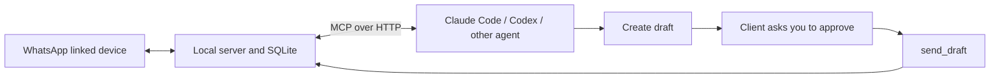

# WhatsApp MCP

Run a local MCP server that lets Claude Code, Codex, and other MCP clients read
your WhatsApp chats, retrieve images and documents, draft replies, and send messages
with your client's approval.

Uses your existing WhatsApp number as a linked device through
[Baileys](https://github.com/WhiskeySockets/Baileys). No WhatsApp Business account,
OpenAI API key, or Anthropic API key is needed by this server. Each person runs
their own instance and pairs their own account. This is an unofficial integration.



## Quick start

Requires Node.js **22.16+** and npm. The optional Claude approval hook uses Python 3. Terminal QR pairing works without a browser
review page. Linux and macOS can run the Node server; the optional launchd helper
is macOS-specific.

```sh
git clone https://github.com/ishwar00/whatsapp-mcp.git
cd whatsapp-mcp
npm ci
npm run build
npm start
```

Keep the server running. In a second terminal, from the same directory:

```sh
npm run owner -- pair
```

Scan the terminal QR with **WhatsApp → Settings → Linked devices → Link a device**.
Then create an agent key. By default it can read and draft, but cannot send:

```sh
npm run owner -- key "My agent"
```

To allow the send tool, first configure your client's approval policy below, then
create a send-enabled key:

```sh
npm run owner -- key "My agent" --send
```

Save the printed bearer token. All chats are available automatically. Only locally
received history is available; pairing or requesting history does not guarantee
that WhatsApp provides every older message. Reading does not mark messages as read.

## Connect Claude Code

Replace `YOUR_CLIENT_KEY` with the token from the key command:

```sh
claude mcp add --transport http whatsapp http://127.0.0.1:3210/mcp \
  --header "Authorization: Bearer YOUR_CLIENT_KEY"
```

For send-enabled keys, copy the included approval hook:

```sh
mkdir -p ~/.claude/hooks
cp examples/claude-send-approval.py ~/.claude/hooks/whatsapp-send-ask.py
```

Merge this into `~/.claude/settings.json`, preserving existing settings:

```json
{
  "permissions": { "ask": ["mcp__whatsapp__send_draft"] },
  "hooks": {
    "PreToolUse": [{
      "matcher": "mcp__whatsapp__send_draft",
      "hooks": [{
        "type": "command",
        "command": "python3 ~/.claude/hooks/whatsapp-send-ask.py"
      }]
    }]
  }
}
```

The hook displays the recipient, exact text, and attachment filenames. Its matcher
assumes you named the MCP connection `whatsapp`.

## Connect Codex

Set `WHATSAPP_BRIDGE_TOKEN` in the environment used to launch Codex. In
`~/.codex/config.toml`:

```toml
[mcp_servers.whatsapp]
url = "http://127.0.0.1:3210/mcp"
bearer_token_env_var = "WHATSAPP_BRIDGE_TOKEN"

[mcp_servers.whatsapp.tools.send_draft]
approval_mode = "prompt"
```

Restart or reconnect the client after changing its settings. Desktop apps need the
token in their own launch environment, not merely an unrelated terminal. See the
[Codex configuration reference](https://developers.openai.com/codex/config-reference).

Other MCP clients can use the same HTTP endpoint and bearer header. Configure
their tool approval to ask before **every** `send_draft`. Clients that cannot
provide this approval should use a key without `--send`.

A stdio adapter is also included for clients that require it. Run
`node /absolute/path/to/whatsapp-mcp/dist/stdio.js` with `WHATSAPP_BRIDGE_TOKEN` set.
It connects to the local HTTP server. Set `WHATSAPP_BRIDGE_URL` to change its URL.

## WhatsApp reply skill

The optional [whatsapp-replies skill](skills/whatsapp-replies/SKILL.md) guides agents
to write conversational replies, keep exact technical values, and choose when to
split a reply into separate messages. It was tuned to Ishwar's chat voice. Use it
as a starting point and adapt the voice references to your own messages.

Ask your agent to install `skills/whatsapp-replies` from this repository for your
client. For a manual installation, run these commands from the repository root:

```sh
# Claude Code
mkdir -p ~/.claude/skills/whatsapp-replies
cp skills/whatsapp-replies/SKILL.md ~/.claude/skills/whatsapp-replies/SKILL.md

# Codex
mkdir -p "${CODEX_HOME:-$HOME/.codex}/skills/whatsapp-replies"
cp skills/whatsapp-replies/SKILL.md "${CODEX_HOME:-$HOME/.codex}/skills/whatsapp-replies/SKILL.md"
```

Start a new session after installing, then ask the agent to use `whatsapp-replies`
when drafting a reply. The skill does not configure MCP access or send approval;
keep the approval policy described above.

## Tools and sending

| Tools | Purpose |
|---|---|
| `get_status`, `list_chats`, `list_participants` | Connection and conversation discovery |
| `read_messages`, `search_messages`, `get_context` | Read, filter, search literal text, and retrieve nearby messages |
| `get_attachment` | Images as MCP image content; files as bounded base64 |
| `create_draft`, `list_drafts`, `get_operation`, `cancel_draft` | Prepare replies and inspect outcomes |
| `send_draft` | Send an exact draft after the client obtains human approval |

Drafting sends nothing. Sending validates the key, recipient name, exact text,
attachment filenames, digest, references, and draft state. Echo the exact
`attachment_names` returned by `create_draft` so the approval shows the filenames.
Each draft supports one image, PDF, text file, or ZIP up to **5 MiB**.

Approval is **client-enforced**. The server does not independently prove a human
approved the call and does not request MCP elicitation. Use client permissions,
not just a prompt instruction, to enforce review. Accepted means provider
acceptance, not delivery. An uncertain or accepted draft is never automatically
resent; inspect WhatsApp before making a replacement draft.

## Identity, edits, and queries

Verified LID/phone mappings produce one direct chat. Old chat and message IDs keep
resolving for drafts, quotes, reactions, and attachments. Duplicate provider IDs
are reconciled: deletion wins, otherwise the latest edit wins. Contacts are never
merged by name. Both historical group sender fields are supported. Plain and
encrypted edits update the original message; reactions expose the emoji and target.

SQLite filters, orders, and limits message reads. Single-chat queries use the
chat/time index; global and multi-chat queries use the global time index.
Continuation pages seek from the last message's time and ID. An unrelated new chat
does not invalidate pagination. Cursors bind the principal and requested filters,
with an observation watermark; edits and deletes are not a frozen snapshot.
Search remains a case-insensitive literal substring search, including Unicode.

## Operation

- State is private local data in `.data`, including linked-device credentials.
  It is not encrypted by this server. Keep it and backups private.
- `BRIDGE_PORT` defaults to `3210`; `BRIDGE_DATA_DIR` defaults to `.data`.
  Use identical values for the server and owner commands.
- `npm run owner -- status` checks the connection.
- `npm run owner -- launchd` generates an optional macOS service definition and
  prints its installation command.
- Stop the server before `npm run owner -- backup /absolute/private/backup`.
  Never start a copied paired session alongside the original.
- Message content expires after 90 days; tombstones prevent stale history from
  restoring it. Message foreign keys and deletion triggers govern all attachment copies.
- Media storage is limited to 512 MiB. No view-once archiving.
- The HTTP server binds to loopback. Remote hosting and multi-user operation are
  outside this project's current setup.

## Development

```sh
npm run check
npm test
npm run build
```

Tests exercise real SQLite, MCP HTTP/stdio transports, combined query filters,
actual query plans, identity migrations, encrypted edits, attachment deletion,
and terminal setup commands. Network sends use a test sender. Account pairing
and real delivery depend on a live WhatsApp account. Baileys is pinned; upgrade it
with linked-device protocol testing.

MIT licensed. See [MCP contract](docs/mcp-contract.md).

## Storage and migrations

Messages, attachment metadata, and attachment bytes live in one SQLite database.
Inline draft creation and its attachment commit or roll back together. Media quotas
count stored bytes in SQLite; updating an attachment replaces its quota usage.
Owner terminal commands authenticate with the local owner bearer key. There are no
browser login cookies, CSRF sessions, or browser review routes.

On first startup after upgrading from file-based media, the server imports each
legacy attachment into SQLite, verifies its digest and size, and commits the whole
import before removing the legacy `media/` directory. Corrupt files abort the import
and leave source files intact. Missing legacy files become unavailable records.
Existing IDs, draft payloads, agent keys and WhatsApp credentials are retained.
Legacy attachments whose message is missing retain their bytes with no message link.
Backups now need only `bridge.sqlite`. The backup command opens the source
database read-only and never migrates it; if a legacy media directory exists, it
copies that too. Before upgrading, stop the server and run the backup command.
The first import temporarily needs space for legacy files, SQLite, and its WAL. To downgrade, stop the service and
restore that whole pre-migration backup before running the old version.
