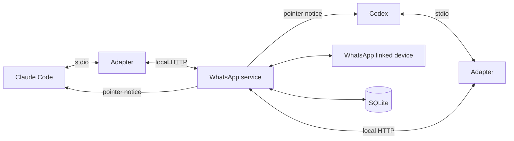

# WhatsApp MCP

Connect Claude Code and Codex to your existing WhatsApp number. Read chats, download attachments, send approved messages, and get notified when replies arrive.

Each person runs one local service and pairs their own account through [Baileys](https://github.com/WhiskeySockets/Baileys). This is an unofficial WhatsApp integration. No WhatsApp Business account is required.

## Set up with your agent

Give your agent this repository and ask:

> Set up WhatsApp MCP locally, start the service at login, and connect this client through the stdio adapter. Require human approval on every `send`. Preserve existing client settings and verify reads without sending a message.

You scan the QR in **WhatsApp → Settings → Linked devices → Link a device**. Your agent can handle the remaining setup.

## Install and pair

Requires Node.js 22.16+ and npm on macOS or Linux.

```sh
git clone https://github.com/ishwar00/whatsapp-mcp.git
cd whatsapp-mcp
npm ci
npm run build
npm start
```

Keep that terminal running. In another terminal, from the repository:

```sh
npm run owner -- pair
npm run owner -- key "My agent" --send
```

Save the printed client key for the configuration below. Omit `--send` for a read-only key.

On macOS, stop the foreground service with Ctrl+C and install the login service:

```sh
npm run owner -- launchd
mkdir -p ~/Library/LaunchAgents
cp com.local.whatsapp-agent-bridge.plist ~/Library/LaunchAgents/
launchctl bootstrap "gui/$(id -u)" ~/Library/LaunchAgents/com.local.whatsapp-agent-bridge.plist
npm run owner -- status
```

On Linux, use your process manager to run `node /absolute/path/to/whatsapp-mcp/dist/main.js` with the repository as the working directory. Run one service per account.

## Connect Claude Code

```sh
claude mcp add --scope user --transport stdio \
  --env WHATSAPP_BRIDGE_TOKEN=YOUR_CLIENT_KEY \
  whatsapp -- node /absolute/path/to/whatsapp-mcp/dist/stdio.js
```

Merge the approval rule into `~/.claude/settings.json`:

```json
{"permissions":{"ask":["mcp__whatsapp__send"]}}
```

The optional [approval hook](examples/claude-send-approval.py) forces an ask decision and displays the recipient, text and file path. Its matcher is `mcp__whatsapp__send`; keep that rule aligned with the MCP connection name.

## Connect Codex

Merge into `~/.codex/config.toml`:

```toml
[mcp_servers.whatsapp]
command = "node"
args = ["/absolute/path/to/whatsapp-mcp/dist/stdio.js"]

[mcp_servers.whatsapp.env]
WHATSAPP_BRIDGE_TOKEN = "YOUR_CLIENT_KEY"

[mcp_servers.whatsapp.tools.send]
approval_mode = "prompt"
```

Use an absolute Node executable path if your desktop client cannot find `node`. Reconnect the client, call `get_status`, and list chats to verify setup. Check that `send` asks for approval before using a send-enabled connection. Approval belongs to the client; the service sends when that tool is called.

## Use the tools

| Tool | What it does |
|---|---|
| `get_status` | Connection, history coverage and your active watches |
| `list_chats` | Find names and aliases, counts and latest activity; `chat_id` includes observed participants |
| `read_messages` | Read, search literal text, filter or retrieve nearby messages |
| `get_attachment` | Write an attachment to disk and return its path; optionally show a small image |
| `send` | Send text or one local file after client approval |
| `sync_history` | Fetch older messages and wait up to 35 seconds |
| `watch` | Notify this agent about incoming replies |
| `unwatch` | Stop a watch |

Send a message with a readable recipient and a unique request ID:

```json
{"chat_id":"chat_...","to":"Samyak","text":"can you check this?","request_id":"dns-followup-1"}
```

For a file, supply an absolute `file_path`; `text` becomes the caption. PNG, JPEG, PDF, ZIP, TXT and DOCX are supported, up to 5 MiB. Reusing the same request ID and payload returns its recorded outcome without sending again. `accepted` means WhatsApp accepted the send, not that it was delivered. For an `unknown` outcome, inspect WhatsApp before sending a replacement.

Attachments download to `~/Downloads/whatsapp/` by default, or an absolute `save_to`. Files are never returned as base64 text. `view:true` includes the original image only when it is at most 1 MB.

To load older conversation, call `sync_history` with `chat_id` and optionally `before_message_id` and `max_batches`. If `done:false`, repeat the same arguments to wait on the shared job. Then issue a fresh `read_messages` query. WhatsApp decides how much history to provide; empty results and timeouts do not prove older messages are absent.

## Get reply notifications

Claude Code identifies its session automatically through the stdio adapter:

```json
{"chat_id":"chat_..."}
```

Codex also supplies `codex_thread_id`, obtained from `$CODEX_THREAD_ID` or `$CODEX_SESSION_ID` in its shell. A watch defaults to the latest outgoing message within 24 hours, and expires after one day. Set `since` or `timeout_seconds` to change those bounds.

Groups notify for replies quoting your outgoing messages, mentions of you, or senders listed in `from_participant_ids`. Other group messages are ignored. The service coalesces replies and sends a notice containing only IDs and a read instruction. The agent retrieves the actual content through `read_messages`. Watching grants no permission to send WhatsApp messages. See [watch setup and behavior](docs/watch.md).

## How it runs



Clients launch their own adapter, which connects to the shared background service at `http://127.0.0.1:3210/mcp`. Set `WHATSAPP_BRIDGE_URL` to change that URL. Streamable HTTP clients can connect directly with `Authorization: Bearer YOUR_CLIENT_KEY`; automatic Claude session routing requires the stdio adapter.

All chats are available automatically. Reads do not mark messages as read. Collection pauses when the service stops, the computer sleeps or the connection goes offline. New pairings request full history; `WHATSAPP_HISTORY_MODE=recent` requests lighter initial sync.

The private `.data` directory holds SQLite, linked-device credentials and the owner key. Messages expire after 90 days; retained media is capped at 512 MiB. Deleted and expired content cannot be restored by stale history. View-once media is not archived. Stop the service before running `npm run owner -- backup /absolute/private/backup`.

## Troubleshoot

- **Connection refused:** start the background service and check `WHATSAPP_BRIDGE_URL`.
- **Unauthorized:** use the printed client bearer token, not its client ID or the owner key.
- **Sending not permitted:** create a key with `--send` after configuring client approval.
- **No notification target:** call from Claude Code through stdio, or supply Codex's thread ID.
- **No older messages:** keep the phone connected and inspect the sync result. A chat needs a known stored message to anchor a history request.

## Development

```sh
npm run check
npm test
npm run build
```

Tests use SQLite and real MCP transports with fixture providers and notification receivers. See the [MCP contract](docs/mcp-contract.md) and [design](docs/design.md). MIT licensed.
