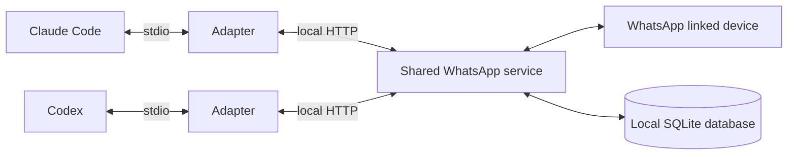

# WhatsApp MCP

Connect Claude Code, Codex, and other MCP clients to your existing WhatsApp account.
Read chats, retrieve images and documents, draft replies, and approve messages before
sending them.

Each person runs their own local service and pairs their own number through
[Baileys](https://github.com/WhiskeySockets/Baileys). This is an unofficial WhatsApp
integration. No WhatsApp Business account, OpenAI API key, or Anthropic API key is
needed by the server.

## Set up with your agent

Give Claude Code or Codex this repository and ask:

> Set up WhatsApp MCP locally. Configure it to start when I log in, connect this
> client through the stdio adapter, and require approval before every send. Follow
> the README, preserve my existing settings, and verify the connection without
> sending a message.

Your agent can handle installation and configuration. You need to scan the pairing
QR in WhatsApp and approve any requested system changes. The steps below also work
for manual setup.

## How it runs



Each client starts its own stdio adapter. The adapter connects to the background
service at `http://127.0.0.1:3210/mcp`; it does not start that service. Keep one
service running per account so clients share the connection and messages can be
received while the clients are closed. Collection pauses when the service is
stopped or the computer is asleep or offline. Older history is not guaranteed.

## Install and pair

Requires Node.js **22.16+** and npm on macOS or Linux. Claude Code's send approval
hook also requires Python 3.

```sh
git clone https://github.com/ishwar00/whatsapp-mcp.git
cd whatsapp-mcp
npm ci
npm run build
npm start
```

Keep this terminal open. In a second terminal, from the same repository directory:

```sh
npm run owner -- pair
```

Scan the QR from **WhatsApp → Settings → Linked devices → Link a device**.
The command prints `WhatsApp: connected` when pairing succeeds.

### Start the service at login

On macOS, stop the foreground server with Ctrl+C, then run from the repository:

```sh
npm run owner -- launchd
mkdir -p ~/Library/LaunchAgents
cp com.local.whatsapp-agent-bridge.plist ~/Library/LaunchAgents/
launchctl bootstrap "gui/$(id -u)" ~/Library/LaunchAgents/com.local.whatsapp-agent-bridge.plist
npm run owner -- status
```

This starts the service now, starts it when you log in, and restarts it if it exits.
Keep the repository and Node executable at their installed paths. Do not also run
`npm start` while this service is loaded.

On Linux, configure your process manager to run `node /absolute/path/to/whatsapp-mcp/dist/main.js`
with the repository as its working directory. Without a process manager, keep
`npm start` running in a terminal.

## Connect your client through stdio

First create a key that can read and draft:

```sh
npm run owner -- key "My agent"
```

Save the printed bearer token. Replace `YOUR_CLIENT_KEY` below with that token and
`/absolute/path/to/whatsapp-mcp` with your checkout path. Use an absolute Node
executable path if your desktop client cannot find `node`.

### Claude Code

```sh
claude mcp add --scope user \
  --env WHATSAPP_BRIDGE_TOKEN=YOUR_CLIENT_KEY --transport stdio \
  whatsapp -- node /absolute/path/to/whatsapp-mcp/dist/stdio.js
```

For send-enabled keys, copy the included approval hook:

```sh
mkdir -p ~/.claude/hooks
cp examples/claude-send-approval.py ~/.claude/hooks/whatsapp-send-ask.py
```

Merge this into `~/.claude/settings.json`, preserving existing settings:

```json
{
  "permissions": { "ask": ["mcp__whatsapp__send_draft"] },
  "hooks": {
    "PreToolUse": [{
      "matcher": "mcp__whatsapp__send_draft",
      "hooks": [{
        "type": "command",
        "command": "python3 ~/.claude/hooks/whatsapp-send-ask.py"
      }]
    }]
  }
}
```

The hook displays the recipient, exact text, and attachment filenames. Its matcher
assumes you named the MCP connection `whatsapp`.

### Codex

Merge this into `~/.codex/config.toml`, preserving existing settings:

```toml
[mcp_servers.whatsapp]
command = "node"
args = ["/absolute/path/to/whatsapp-mcp/dist/stdio.js"]

[mcp_servers.whatsapp.env]
WHATSAPP_BRIDGE_TOKEN = "YOUR_CLIENT_KEY"

[mcp_servers.whatsapp.tools.send_draft]
approval_mode = "prompt"
```

The token is passed directly to the adapter, including when Codex launches from a
desktop app. Keep this user configuration private. See the
[Codex configuration reference](https://developers.openai.com/codex/config-reference).

### Enable sending and verify

After configuring send approval in your client, create a send-enabled key:

```sh
npm run owner -- key "My agent with sending" --send
```

Replace the token in that client's MCP configuration with the new key. Keep the
first key if you want a separate connection that can only read and draft.
Restart or reconnect your client, then ask it to call `get_status` and list chats.
The status should report `connected`. No message needs to be sent to verify setup.

All chats are available automatically. Reading does not mark messages as read.
Only history received by this service is available; pairing and history requests
do not guarantee that WhatsApp supplies every older message.

### Other clients and direct HTTP

Clients with stdio support can run the same `dist/stdio.js` command with
`WHATSAPP_BRIDGE_TOKEN` set. To change its destination, set
`WHATSAPP_BRIDGE_URL` to the service's full MCP URL.

Clients with Streamable HTTP support can connect directly to
`http://127.0.0.1:3210/mcp` using `Authorization: Bearer YOUR_CLIENT_KEY`.
Both transports use the same service, keys, and tools. Require approval before
**every** `send_draft`. If a client cannot enforce approval, use a key without
`--send`.

## Tools and sending

| Tools | Purpose |
|---|---|
| `get_status`, `list_chats`, `list_participants` | Connection and conversation discovery |
| `read_messages`, `search_messages`, `get_context` | Read, filter, search literal text, and retrieve nearby messages |
| `get_attachment` | Images as MCP image content; files as bounded base64 |
| `create_draft`, `list_drafts`, `get_operation`, `cancel_draft` | Prepare replies and inspect outcomes |
| `send_draft` | Send an exact draft after the client obtains human approval |

Drafting sends nothing. Sending validates the key, recipient name, exact text,
attachment filenames, digest, references, and draft state. Echo the exact
`attachment_names` returned by `create_draft` so the approval shows the filenames.
Each draft supports one image, PDF, text file, or ZIP up to **5 MiB**.

Approval is **client-enforced**. The server does not independently prove a human
approved the call. Use client permissions,
not just a prompt instruction, to enforce review. Accepted means provider
acceptance, not delivery. An uncertain or accepted draft is never automatically
resent; inspect WhatsApp before making a replacement draft.

## Load older conversations

Ask your agent to "load the September conversation in this chat" or "search older
messages for the DNS change". The service stores retrieved history so every connected
agent can reuse it.

- `get_history_coverage` shows stored message dates and count for a chat. These are
  bounds, not proof that every message between them is present.
- `sync_history` takes `chat_id`, an optional `sent_at` date range, and `max_batches`
  from 1 to 10, default 3. Each batch requests 50 messages before the oldest stored
  raw message. With a range, it stops when the oldest stored date reaches `from`.
  `to` describes the intended read range; it does not make WhatsApp jump to that date.
- Poll `get_history_status` using the returned `id` as `job_id`, then read or search
  the requested range. Jobs survive client disconnects. A service restart marks
  unfinished jobs `interrupted`; it does not silently retry them.
- `read_messages` and `search_messages` accept `fetch_history: true` and
  `max_history_batches` when exactly one chat is selected and no page cursor is used.
  They return local results immediately plus a background job. Poll it, then repeat
  the query without `fetch_history` or a page cursor to include arriving messages.

Terminal outcomes distinguish `target_reached`, `batch_limit`, `no_progress`,
`timed_out`, `no_anchor`, `offline`, `failed`, and `interrupted`. None proves that
WhatsApp has no older messages. Duplicate responses stop automatic pagination.
Requests are serialized, and an active request for the same chat is shared. If
another request joins it, inspect the returned job's date range and batch budget.

A batch waits up to 30 seconds for a matching history event. A submitted request
alone is not success. The phone must be able to respond. Chats with no stored raw
message need initial history or a new message before they have a usable anchor.

New pairings use Baileys' desktop profile with `syncFullHistory: true` to request
broader initial history. Existing pairings keep their previous profile, which is
saved across restarts. Set `WHATSAPP_HISTORY_MODE=recent` on the service for the
lighter sync mode. Changing an existing pairing to `desktop` may prevent it from
connecting, and does not guarantee a new full import. Use a fresh pairing if you
need to change device profile. `get_status.history_sync` reports the configured mode and last
history event or phase. Scrolling a separate WhatsApp Web session does not populate
this service. Disappearing, deleted, expired, and view-once content still follows
the existing retention rules.

## Data and operation

- Messages and attachment bytes are stored locally in `.data/bridge.sqlite`.
  Linked-device credentials and the owner key are also stored in `.data`.
  The server does not encrypt this directory. Keep it and backups private.
- Message content expires after 90 days. Deleted and expired messages cannot be
  restored by stale history events. Their stored attachments are also removed.
- Media storage is limited to 512 MiB. View-once media is not archived.
- Edits update the original message. Reactions include the emoji and target message.
  Verified WhatsApp identity mappings reconcile direct chats; names alone do not
  merge contacts.
- Message tools support filtered reads and pagination. Text search matches literal
  substrings without case sensitivity. See the [MCP contract](docs/mcp-contract.md)
  for tool parameters and result semantics.
- Run `npm run owner -- status` from the repository to check the connection.
- To back up the database, stop the service and run
  `npm run owner -- backup /absolute/private/backup`. Restart the service afterward.
  The database backup does not include linked-device credentials or owner keys.
  Never run a copied paired session alongside the original.
- The HTTP service binds to loopback. The documented setup is for local clients
  on the same computer.

| Setting | Default | Used by |
|---|---|---|
| `BRIDGE_DATA_DIR` | `.data` relative to the working directory | Service and owner commands |
| `BRIDGE_PORT` | `3210` | Service and owner commands |
| `WHATSAPP_HISTORY_MODE` | `desktop` for new pairings; saved profile for existing pairings | Service |
| `WHATSAPP_BRIDGE_TOKEN` | Required | Stdio adapter |
| `WHATSAPP_BRIDGE_URL` | `http://127.0.0.1:3210/mcp` | Stdio adapter |

Use the same data directory and port for the service and owner commands. The macOS
helper records the data directory in its generated service definition. If you use
a custom port, also add `BRIDGE_PORT` to that definition's `EnvironmentVariables`
and update the adapter URL.

## Troubleshooting

- **Connection refused:** the adapter needs the background service. Check that the
  service is running and that its port matches `WHATSAPP_BRIDGE_URL`.
- **Node not found:** use the absolute path returned by `command -v node` in the
  client's MCP configuration.
- **Unauthorized:** check the agent token. Use the key command's bearer token,
  not the owner key or client ID.
- **Sending not permitted:** the connection needs a key created with `--send`.
  Configure client approval before using that key.
- **No approval prompt:** stop using the send-enabled connection until the client
  policy is configured to ask. The service relies on that policy.
- **Pairing timed out:** run `npm run owner -- pair` again. If status reports
  `reauth_required`, stop the service and pair with a new `BRIDGE_DATA_DIR`.

## Development

```sh
npm run check
npm test
npm run build
```

Tests use real SQLite and MCP transports, with a test sender for network sends.
Pairing and delivery require a live WhatsApp account.

MIT licensed. See the [design](docs/design.md) and [MCP contract](docs/mcp-contract.md).
