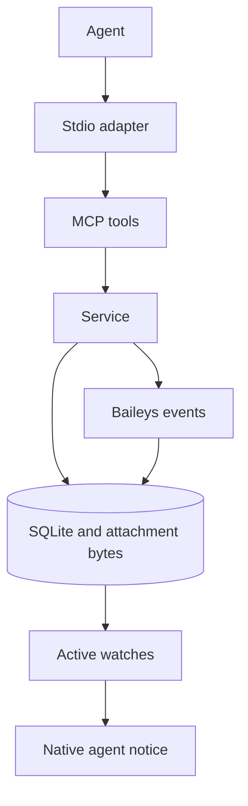

# Local WhatsApp MCP design

One daemon owns the linked-device socket, authentication and SQLite store. Client-launched stdio adapters forward tools over authenticated loopback HTTP. This keeps the WhatsApp connection alive independently of an agent session.

`store.ts` owns message queries, verified identity reconciliation, retained names, erasure and attachment storage. `whatsapp.ts` translates provider events and authenticates encrypted edits. `history.ts` owns bounded on-demand retrieval. `service.ts` implements compact reads and idempotent sends; `mcp.ts` validates tool arguments and writes requested downloads to disk.

Each send records an attempt before provider dispatch. The per-key request ID prevents a repeated or interrupted operation from sending twice. Human approval remains the client's permission rule on `send`.

`watches.ts` persists active subscriptions and native delivery targets. It groups incoming messages and matches owner quotes, owner mentions and selected group senders. Other group messages are recorded as handled without notifying. Only fixed pointer notices enter the agent session; the agent reads WhatsApp content through tools. `process.ts` contains executable lookup and bounded Codex queue execution.

A local bearer key accesses all chats. Keys are hashed in storage. The service binds to loopback with Host and Origin checks. Agent keys cannot use owner endpoints. The data directory and native delivery credentials share the local user's trust boundary.

SQLite retains messages, aliases, names, authentication and capped attachment bytes. Erasure triggers remove content and media for deleted or expired messages. Verified LID/phone mappings merge identities; names are search aliases, never identity evidence. Older history remains partial even when the connection is healthy.
