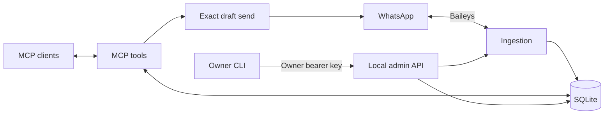

# Architecture

One local process owns one WhatsApp linked device and one SQLite database. Agents
connect using MCP. The terminal owner command manages pairing and agent keys.

## Storage ownership

- `store.ts` owns messages, verified identity reconciliation, key authorization,
  draft persistence, and message query construction.
- `media.ts` owns attachment rows and BLOB bytes in that same database. Foreign
  keys reference messages; tombstone triggers erase all associated media and raw
  content. Stored media cannot be attached to deleted messages.
- Protocol credentials, raw messages, drafts and settings remain typed objects.
  Attachment metadata is stored in explicit columns rather than that object store.
- `service.ts` validates draft operations and references. Creating an inline
  attachment and its draft happens in one SQLite transaction.
- `whatsapp.ts` adapts Baileys events and sends. Raw protocol identities are retained
  where cryptographic verification requires them.

Verified LID/phone mappings reconcile chats and duplicate provider message IDs.
Old IDs redirect to the retained row, so drafts and reply references survive. A
deletion wins over duplicate content; otherwise the latest edit wins. Attachments
move to the retained message before the losing message is deleted.

## Access and approval

Agent bearer keys can read all chats. Draft and send permissions are separate.
Every request rechecks that the key is enabled. Owner administration uses a separate
local bearer key, with loopback binding and Host/Origin checks. There are no browser
sessions or review pages.

The human send gate belongs to the MCP client. It must prompt for every
`send_draft`. The server validates exact recipient name, text, filenames and digest,
then records the attempt before calling WhatsApp. Accepted and uncertain operations
are never automatically retried.

## Queries and migration

Read filters compile into parameterized SQL. Single-chat reads use a chat/time
index; global and multi-chat reads use a global time index. Pagination uses time
and ID bounds. Search retains literal Unicode substring semantics.

Legacy media imports in one transaction. Bytes are verified before commit, and
source files are removed afterward. Missing-message attachments become unattached
records; missing files become unavailable. Corrupt bytes fail with the attachment
ID and leave the source intact. Backups read SQLite directly without constructing
Store, so a pre-upgrade backup cannot trigger migration.
